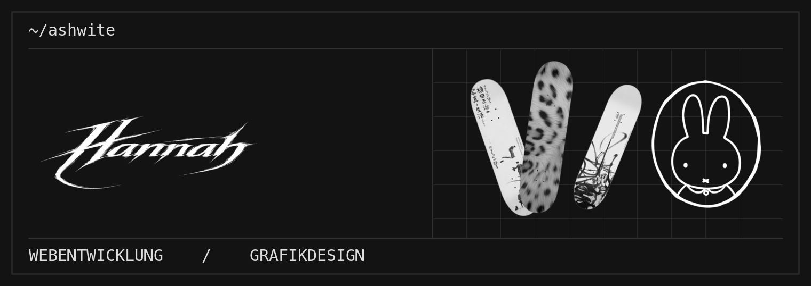

<p align="center">
  
</p>

### `~/ashwite/about`

```toml
name       = "Hannah"
ausbildung = "Fachinformatikerin für Anwendungsentwicklung"
interessen = ["Webentwicklung", "Grafikdesign"]
style      = ["Schwarzweiß", "Pixelschrift", "Cybersigilism"]
```

Ich setze meine Designideen am liebsten selbst als Website um. In meinem Portfolio sind die Skateboards zum Beispiel die Navigation.

<details>
  <summary>🐇 mehr über mich</summary>
  <p>Ich mag Studio Ghibli, Miffy und weißes Monster. Das silberne Muster auf der Dose hat mich schon beim Gestalten inspiriert.</p>
</details>

### `~/ashwite/projekte`

| Projekt | Was drinsteckt |
| --- | --- |
| [Portfolio ↗](https://gitlab.com/ashwite/myspace) | Mein eigenes Design als Website mit React und TypeScript. |
| [brainly ↗](https://github.com/ashwite/brainly) | Sudoku, Mudoku und eine Wortleiter mit gemeinsamem XP-System. |
