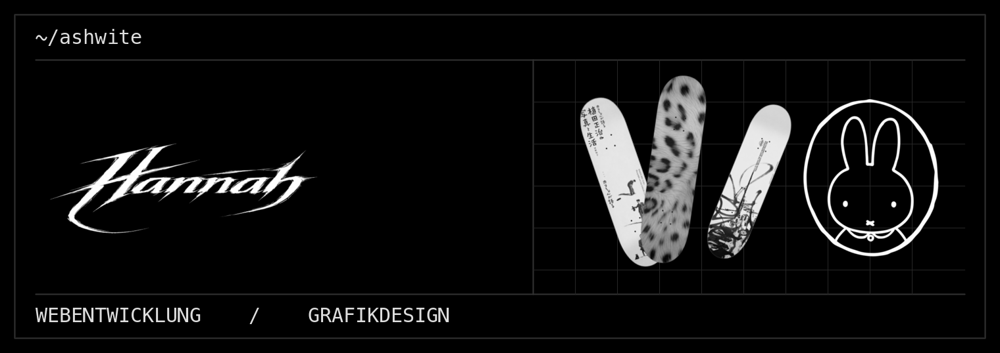
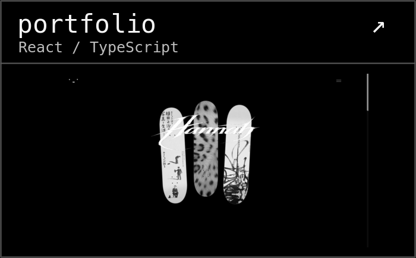
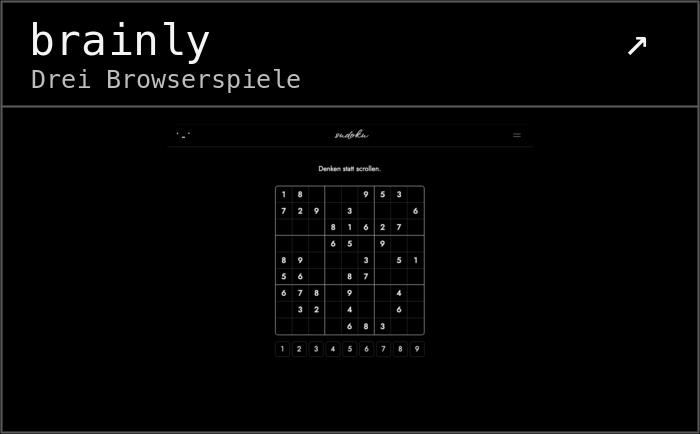

  

### hi, ich bin Hannah.

Ich mache eine Ausbildung zur Fachinformatikerin für Anwendungsentwicklung. Am liebsten entwerfe ich eine Website und setze sie dann selbst um. In meinem Portfolio kannst du zum Beispiel auf ein Skateboard klicken, um zur nächsten Seite zu kommen.

**Was ich mag** · Miffy, Studio Ghibli, Cybersigilism und die silbernen Linien auf weißem Monster.

### projekte

  
  

